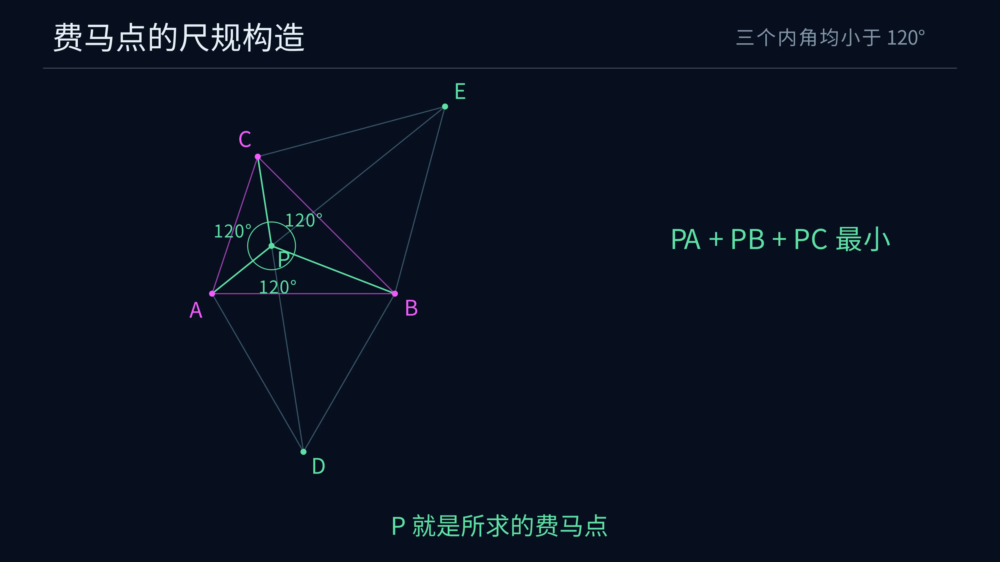

# Euclid-Fermat-Point · 费马—托里拆利点

**给定不共线三点，用无刻度直尺和圆规，构造到这三点的距离之和在整个平面上最小的点。**

本项目是 Euclid 几何研究系列的第八题，内容为完整尺规作图、全平面最小性与唯一性证明，以及 Manim 作图动画。题面覆盖全部非退化三角形，包含某个内角恰好等于 $120^\circ$ 的临界情形。

[观看 4K60 作图动画](animations/fermat/media/FermatPoint_4k60.mp4) · [完整作图答案](docs/ANSWER.md) · [正确性证明](docs/PROOF.md) · [题面与工具](docs/DESIGN.md)

*点击预览图观看或下载动画，3840 × 2160、60 fps、39.6 秒。*

## 题目与结论

给定欧氏平面内不共线的三点 $A,B,C$，构造点 $P$，使

$$f(P)=PA+PB+PC$$

在整个平面上取得最小值。每个合法输入都有唯一的最小点。

| 三角形的内角 | 唯一最小点 |
|---|---|
| 三个内角均小于 $120^\circ$ | 严格位于三角形内部，且 $\angle APB=\angle BPC=\angle CPA=120^\circ$ |
| 某个内角等于 $120^\circ$ | 该角的顶点 |
| 某个内角大于 $120^\circ$ | 该角的顶点 |

内角达到 $120^\circ$ 的顶点至多有一个。分支判断可通过等圆上的弦长比较完成，所有辅助点均由直线与圆的交点取得。[完整分支判定](docs/ANSWER.md) · [一般证明](docs/PROOF.md)

## 构造主线

1. 依次检查三个内角与 $120^\circ$ 的大小关系。若某角达到或超过 $120^\circ$，输出该顶点。
2. 三角均小于 $120^\circ$ 时，在 $AB$ 外侧作等边三角形 $ABD$，在 $BC$ 外侧作等边三角形 $BCE$。
3. 连接 $C,D$ 和 $A,E$，取两条直线的交点 $P$。

外侧由第三个给定点相对于边线的异侧关系确定。两条连接线在这个分支始终不同且相交，交点位于两条线段的内部。完整答案展开了判角所用的圆、两个等边三角形的交点选择，以及最终输出。[逐步作法](docs/ANSWER.md)

## 证明内容

证明先确定最小点的存在性与唯一性，再给出顶点分支的充分必要条件。内部最小点的三条单位方向向量之和为零，故三组夹角均为 $120^\circ$。随后用 $60^\circ$ 旋转证明该点同时落在 $CD$ 与 $AE$ 上，完成作图存在性和正确性的论证。

另给出直接的几何下界。任取平面点 $Q$，将它绕 $A$ 顺时针旋转 $60^\circ$ 得到 $Q'$，则

$$QA+QB+QC=QQ'+Q'D+CQ\ge CD.$$

构造点对应的四点按 $C,P,P',D$ 顺序共线，因此达到下界。顶点分支用单位方向向量的支撑不等式证明，临界角同样具有唯一最小点。[全平面最小性、等号与唯一性](docs/PROOF.md)

## 动画

沿用系列的深蓝背景、中文说明和细线几何。洋红表示给定点，金色表示当前动作，淡蓝表示辅助对象，绿色表示结果。

动画采用三个内角均小于 $120^\circ$ 的一个案例，展示外作两个等边三角形、连接取交点和三组 $120^\circ$，再用一段简短旋转说明距离和的下界。等边三角形用圆规短弧作出，每步配一句操作说明，右侧保留必要等式。分镜、渲染命令和预览见 [动画说明](animations/fermat/README.md)。

## 文档入口

| 内容 | 文件 |
|---|---|
| 输入、输出、尺规工具和分支规则 | [DESIGN](docs/DESIGN.md) |
| 判角、完整作图、精确案例与特殊输入 | [ANSWER](docs/ANSWER.md) |
| 存在性、唯一性、构造正确性和几何极值证明 | [PROOF](docs/PROOF.md) |
| Manim 动画、数据与复现 | [动画目录](animations/fermat/README.md) |

## 来源与项目定位

本题及外作等边三角形的构造属于经典费马—托里拆利问题。本项目依照《Euclid 十题研究路线图》第八题整理，提供全输入域证明、可执行尺规步骤与对应动画。路线图列出的现代讨论为 *The Fermat-Torricelli Problem Revisited*。[研究路线图](https://github.com/lenovobenben/euclid-conic-classification/blob/main/docs/Euclid十题研究路线图.md) · [文献入口](https://doi.org/10.1007/s00591-025-00402-y)

**Euclid 几何研究系列**

[Euclid-Min](https://github.com/lenovobenben/euclid-min) · [Euclid-CCC-Min](https://github.com/lenovobenben/euclid-ccc-min) · [Euclid-Equal-Angle-Min](https://github.com/lenovobenben/euclid-equal-angle-min) · [Euclid-Castillon-Min](https://github.com/lenovobenben/euclid-castillon-min) · [Euclid-Conic-Classification](https://github.com/lenovobenben/euclid-conic-classification) · [Euclid-Cubic-Trisection](https://github.com/lenovobenben/euclid-cubic-trisection) · [Euclid-Square-Reconstruction](https://github.com/lenovobenben/euclid-square-reconstruction) · **Euclid-Fermat-Point** · [Euclid-Quadrilateral-Centroid](https://github.com/lenovobenben/euclid-quadrilateral-centroid) · [Euclid-Quadrature](https://github.com/lenovobenben/euclid-quadrature)
