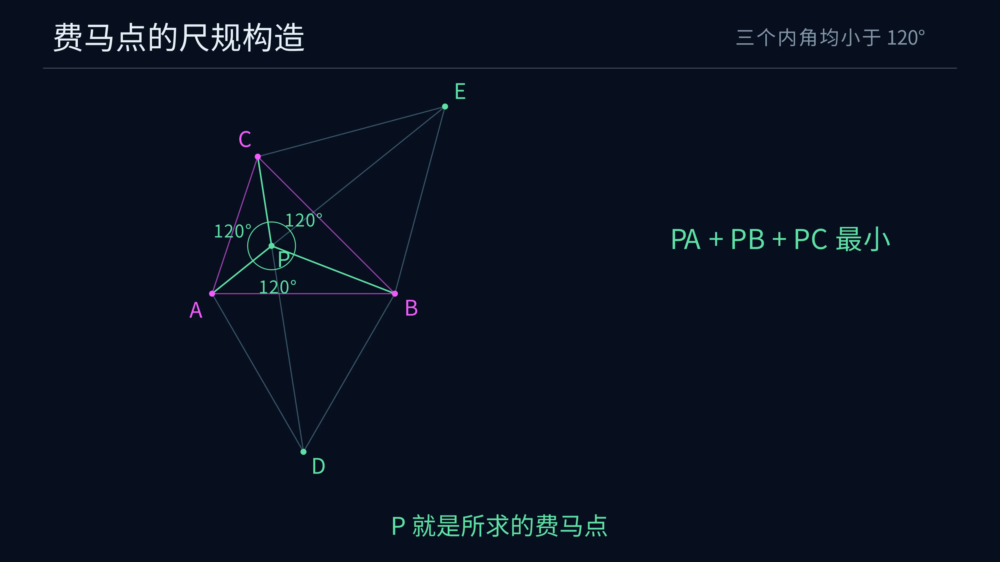

# 费马—托里拆利点的尺规作图与极值证明动画

[观看 4K60 MP4](media/FermatPoint_4k60.mp4)

成片时长 39.6 秒，分辨率 3840 × 2160，帧率 60 fps。



## 展示内容

动画采用 [完整答案](../../docs/ANSWER.md) 中三个内角均小于 $120^\circ$ 的案例，连续展示尺规构造与一段简短的旋转证明。

| 阶段 | 图形与说明 |
|---|---|
| 给定三点 | 标明三个内角均小于 $120^\circ$，求距离和最小点 |
| 外作等边三角形 | 用两组圆规短弧，依次取得 $D,E$ 并连接三角形边 |
| 取得费马点 | 连接 $CD,AE$，交于 $P$ |
| 三组夹角 | 标记 $PA,PB,PC$ 之间的三个 $120^\circ$ |
| 简短证明 | 将线段 $BQ$ 绕 $A$ 顺时针旋转 $60^\circ$ 至 $DQ'$，展示 $Q'D=QB$，再把三个距离转为折线 $CQQ'D$，得到下界 $CD$ |
| 达到最小值 | 同步移动至 $P,P'$，折线伸直，回到完成的构造图 |

动画中的 $Q$ 采用一个具体位置演示旋转，文档对平面上全部 $Q$ 证明同一个不等式。[一般证明](../../docs/PROOF.md)

## 几何案例

内部分支采用

$$A=(0,0),\quad B=(4,0),\quad C=(1,3),$$

$$D=(2,-2\sqrt3),\qquad
E=\left(\frac{5+3\sqrt3}{2},\frac{3+3\sqrt3}{2}\right),$$

$$P=\left(\frac{10+4\sqrt3}{13},\frac{24-6\sqrt3}{13}\right).$$

旋转证明用 $Q=(14/5,8/5)$。$Q'$ 和 $P'$ 均由相同的绕 $A$ 顺时针 $60^\circ$ 旋转取得。同步移动采用线性插值，因旋转为仿射映射，中间的每一帧也保持相同旋转关系。

## 视觉与显示

沿用 Euclid 系列的深蓝背景 `#07101F`、Noto Sans CJK SC 中文字体、细线和无填充圆。洋红表示给定点，金色表示当前作图，淡蓝表示辅助对象，绿色表示构造结果。

等边三角形以交点附近的短圆弧表现圆规作图。标题固定，底部每步一句话，右侧显示必要等式。旋转证明单独显示 $C,Q,Q',D$，末尾回到完成的构造图。

动画以 [manim.cfg](manim.cfg) 固定 3840 × 2160、60 fps。每次渲染在视频旁输出分镜时间线，记录场景源码摘要、几何数据摘要、尺寸、帧率和各段起始时间。

## 数据生成与检查

[export_geometry.py](export_geometry.py) 使用 SageMath 10.7 的精确实代数数域 `AA`。两个外作等边顶点由两圆求交取得，再按异侧选择，最终 $P$ 由两条直线求交取得。

导出前检查的关系包括

1. 每个两圆交点到两个圆心的距离都等于相应半径。
2. 弦长判角与精确余弦判角相符。
3. 内部交点严格位于三角形内，三对方向内积均对应 $120^\circ$。
4. $P$ 位于 $CD,AE$ 两条线段的严格内部，两条连接线段等长。
5. 主案例的三个距离之和等于 $CD$，并等于 $\sqrt{22+12\sqrt3}$。
6. 旋转满足 $QQ'=QA$、$Q'D=QB$，达到等号时 $C,P,P',D$ 按顺序共线。
7. 恰为 $120^\circ$、大于 $120^\circ$ 以及相距临界输入 $10^{-30}$ 的两侧案例进入正确分支。

共检查 9 类案例及 28 次置换、反射、平移和缩放后的重放。一般证明保存在 [PROOF](../../docs/PROOF.md)，这些检查用于核对动画的实际几何数据。

导出的 [geometry.json](geometry.json) 只在绘制阶段使用浮点数。[geometry.sha256](geometry.sha256) 校验显示数据，Manim 加载时还检查数据生成源码摘要和检查标记。

## 复现

以下命令均在项目根目录执行。SageMath 使用与前几题相同的固定镜像。

```powershell
docker run --rm --network none -e PYTHONDONTWRITEBYTECODE=1 -e OPENBLAS_NUM_THREADS=1 -v "${PWD}:/workspace" -w /workspace sagemath/sagemath@sha256:4f5589eb6c565949a006f8665de2876b8414410daf5ac554f4434a15d4f3d528 sage -python animations/fermat/export_geometry.py
```

动画使用 Manim Community 0.21.0 与 Noto Sans CJK SC。已有系列镜像 `euclid-min-manim:0.21.0` 时可直接渲染。需要重建时使用本目录的 Dockerfile。

```powershell
docker build -t euclid-min-manim:0.21.0 animations/fermat
```

渲染 4K60 成片

```powershell
docker run --rm --network none -e PYTHONDONTWRITEBYTECODE=1 -v "${PWD}:/manim" -w /manim euclid-min-manim:0.21.0 manim --config_file animations/fermat/manim.cfg -o FermatPoint_4k60.mp4 animations/fermat/fermat.py FermatPoint
```

预览渲染增加 `-r 1280,720 --fps 30`，并将输出名改为 `FermatPoint_720p30.mp4`。

将最终视频复制为索引前置的播放文件，并复制对应时间线

```powershell
ffmpeg -y -i animations/fermat/media/videos/fermat/2160p60/FermatPoint_4k60.mp4 -c copy -movflags +faststart animations/fermat/media/FermatPoint_4k60.mp4
Copy-Item -LiteralPath animations/fermat/media/videos/fermat/2160p60/FermatPoint_4k60.timeline.json -Destination animations/fermat/media/FermatPoint_4k60.timeline.json
```

末尾的完成图用于预览。在成片结束前两秒取帧即可重建 `preview.png`。

```powershell
ffmpeg -y -sseof -2 -i animations/fermat/media/FermatPoint_4k60.mp4 -frames:v 1 -update 1 animations/fermat/preview.png
```
